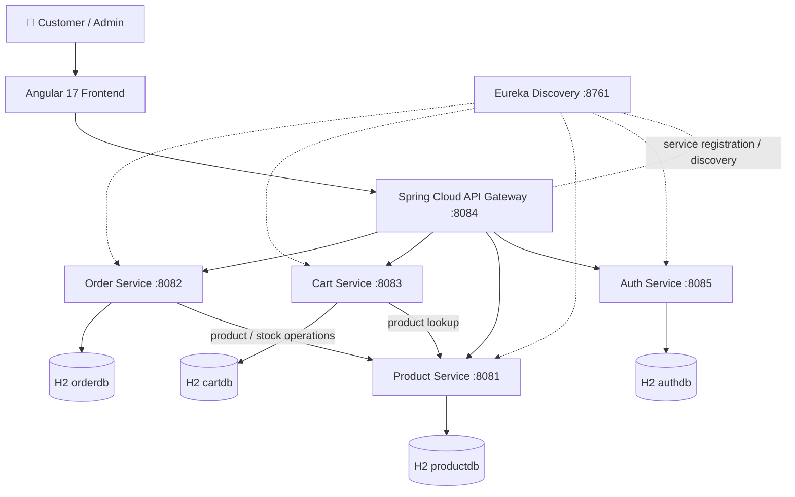

<div align="center">

# 🛒 Tata Kirana
### Fresh groceries, smoother shopping.

**A full-stack grocery shopping platform built with Angular 17 and Spring Boot microservices.**

[](https://angular.dev/)
[](https://spring.io/projects/spring-boot)
[](https://openjdk.org/)
[](https://www.typescriptlang.org/)
[](https://render.com/)

[🌐 **Live App**](https://tata-kirana.onrender.com/) · [⚙️ **API Gateway**](https://api-gateway-u3au.onrender.com/actuator/health) · [💻 **Source Code**](https://github.com/amankamlesh/tata_kirana)

</div>

---

## ✨ Overview

**Tata Kirana** is a responsive grocery e-commerce application that connects a modern Angular storefront to a **six-module Spring Boot microservices backend**. Customers can discover groceries, maintain a cart, place orders, and view order history. Administrators have separate screens for managing products and reviewing orders.

The project demonstrates **REST API design, service discovery, gateway routing, service-to-service communication, role-based UI routing, and cloud deployment**.

> **Demo note:** This is a portfolio/learning project. Hosted services on Render may need time to wake up, and functionality can be affected by service availability. The current services use **in-memory H2 databases**; data is not durable across application restarts.

## 🖥️ Application highlights

| 🛍️ Customer experience | 🛠️ Administration |
|:---|:---|
| Browse and search the product catalog | View the product catalog |
| View product details | Add and edit products |
| Register, log in, and manage a profile | Delete and manage products |
| Add items, change quantities, and clear cart | Review customer orders |
| Enter a delivery address and place an order | Update order status |
| View order history and order details | Access admin-only routes |

**Checkout UI:** The source displays a ₹49 delivery charge for subtotals below ₹499 and free delivery from ₹499. This is the *frontend display rule*; delivery pricing should also be enforced in trusted backend logic.

## 🧰 Tech stack

| Layer | Technology |
|---|---|
| Frontend | Angular 17, TypeScript, standalone components, Angular Signals |
| UI | Tailwind CSS, responsive styles, Reactive Forms |
| Backend | Java 17, Spring Boot 3.2.1 |
| Microservices | Spring Cloud 2023.0.0, Spring Cloud Gateway, Netflix Eureka |
| Persistence | Spring Data JPA, Hibernate, H2 (in-memory) |
| Service communication | REST APIs, OpenFeign / service discovery |
| Build tools | npm, Angular CLI, Maven |
| Deployment | Render, Dockerfiles for individual services |

## 🏗️ System architecture



### Services at a glance

| Module | Default local port | Responsibility |
|---|---:|---|
| Eureka Server | `8761` | Service registry and discovery |
| API Gateway | `8084` | Routes client requests to backend services |
| Auth Service | `8085` | Registration, login, profile, password management |
| Product Service | `8081` | Product search, catalog, CRUD, quantity updates |
| Cart Service | `8083` | Customer carts and cart item operations |
| Order Service | `8082` | Order creation, history, details, status and cancellation |

## 📁 Project structure

```text
tata_kirana/
├── ecomGroceryApp_Frontend/
│   ├── src/app/
│   │   ├── core/
│   │   │   ├── guards/         # Auth & admin route guards
│   │   │   ├── interceptors/   # Auth HTTP interceptor
│   │   │   └── services/       # Auth, cart, products, orders
│   │   ├── models/             # TypeScript API models
│   │   ├── pages/
│   │   │   ├── admin/          # Product & order management
│   │   │   ├── auth/           # Login, register, change password
│   │   │   ├── cart/
│   │   │   ├── checkout/
│   │   │   ├── orders/
│   │   │   ├── product-detail/
│   │   │   ├── profile/
│   │   │   └── shop/
│   │   └── shared/components/
│   ├── package.json
│   ├── angular.json
│   └── proxy.conf.json
│
├── ecomGroceryApp_Backend/
│   ├── eureka-server/
│   ├── api-gateway/
│   ├── auth-service/
│   ├── product-service/
│   ├── cart-service/
│   ├── order-service/
│   ├── Dockerfile.auth
│   ├── Dockerfile.cart
│   ├── Dockerfile.eureka
│   ├── Dockerfile.gateway
│   ├── Dockerfile.order
│   ├── Dockerfile.product
│   └── pom.xml
└── README.md
```

## 🚀 Run locally

### Prerequisites

- **Java 17** and **Maven**
- **Node.js** with **npm**
- **Git**

### 1. Clone the repository

```bash
git clone https://github.com/amankamlesh/tata_kirana.git
cd tata_kirana
```

### 2. Build the backend modules

```bash
cd ecomGroceryApp_Backend
mvn clean install -DskipTests
```

### 3. Start the backend services

Open **separate terminals** in `ecomGroceryApp_Backend`. Start Eureka first, then services, then the gateway:

```bash
mvn -pl eureka-server spring-boot:run
```

```bash
mvn -pl auth-service spring-boot:run
```

```bash
mvn -pl product-service spring-boot:run
```

```bash
mvn -pl cart-service spring-boot:run
```

```bash
mvn -pl order-service spring-boot:run
```

```bash
mvn -pl api-gateway spring-boot:run
```

> **Local configuration note:** Some service properties currently enable HTTPS Eureka registration for Render. For local development, you may need to set `eureka.instance.non-secure-port-enabled=true`, `eureka.instance.secure-port-enabled=false`, and `eureka.instance.prefer-ip-address=true` for relevant services. Ensure each service registers an address and port reachable by the gateway.

### 4. Start the Angular frontend

From the repository root:

```bash
cd ecomGroceryApp_Frontend
npm install
npm start
```

Open **http://localhost:4200**.

The repository includes `proxy.conf.json` to forward `/api` requests to **http://localhost:8084**. **Important:** the frontend currently contains deployed API URLs in some services, so adjust those URLs to `/api/...` for a fully local setup.

## 🔗 API reference

The gateway routes all API requests under the following prefixes:

| Service | Gateway prefix | Examples |
|---|---|---|
| Authentication | `/api/auth` | `POST /register`, `POST /login`, `GET /profile/{customerId}` |
| Products | `/api/products` | `GET /`, `POST /add`, `PUT /{id}`, `DELETE /{id}` |
| Cart | `/api/cart` | `POST /`, `GET /{customerId}`, `DELETE /clear/{customerId}` |
| Orders | `/api/orders` | `POST /add`, `GET /customer/{customerId}`, `GET /get-all-orders` |

Local API Gateway: `http://localhost:8084`

Example:

```bash
curl http://localhost:8084/api/products
```

Health endpoint (where Actuator is available):

```text
http://localhost:8084/actuator/health
```

### Authentication & navigation

- Angular **auth guard** protects cart, checkout, profile, and orders.
- Angular **admin guard** protects product and order management pages.
- An **HTTP interceptor** is available for authentication-related requests.
- Backend permissions should be verified independently; route guards alone do not provide server-side access control.

## ☁️ Deployment

Services are structured for deployment on **Render**, with separate Dockerfiles for each backend module.

| Component | Link |
|---|---|
| 🌐 Angular storefront | [tata-kirana.onrender.com](https://tata-kirana.onrender.com/) |
| ⚙️ Backend gateway health | [api-gateway-u3au.onrender.com/actuator/health](https://api-gateway-u3au.onrender.com/actuator/health) |

For deployment, configure the Eureka URL, advertised service hostname, gateway routing, CORS origin, and each service's `PORT`. The exact configuration depends on the Render services being used.

**Note:** URLs indicate deployment endpoints, not a guaranteed current uptime status.

## 🧠 What this project demonstrates

- Building an **Angular standalone-component** storefront with reusable UI
- Managing UI state with **Angular Signals**
- Implementing reactive forms, authentication-aware navigation, and HTTP services
- Designing **independent Spring Boot microservices**
- Using **Eureka service discovery** and **Spring Cloud Gateway**
- Connecting services via REST and product lookup clients
- Structuring Java applications with controllers, DTOs, services, repositories, and entities
- Working with JPA, Hibernate, and lightweight service databases
- Packaging components for cloud deployment and debugging distributed-service issues

## 🗺️ Roadmap

- [ ] Migrate H2 to a durable production database
- [ ] Centralize frontend API environment configuration
- [ ] Strengthen server-side authorization and secure cross-service calls
- [ ] Add resilient retries, timeouts, and circuit breakers
- [ ] Improve stock consistency and order transaction handling
- [ ] Add integration and end-to-end tests
- [ ] Set up CI/CD and automated quality checks
- [ ] Add verified application screenshots and a walkthrough video

## 👨‍💻 Developer

**Aman Mahor**  
B.Tech, Electrical Engineering — National Institute of Technology, Surat

[](https://github.com/amankamlesh)
[](https://www.linkedin.com/in/aman-mahor-4589a6229/)

---

<div align="center">

**⭐ If this project helped you, consider starring the repository!**

Made with ☕, Angular & Spring Boot.

</div>
